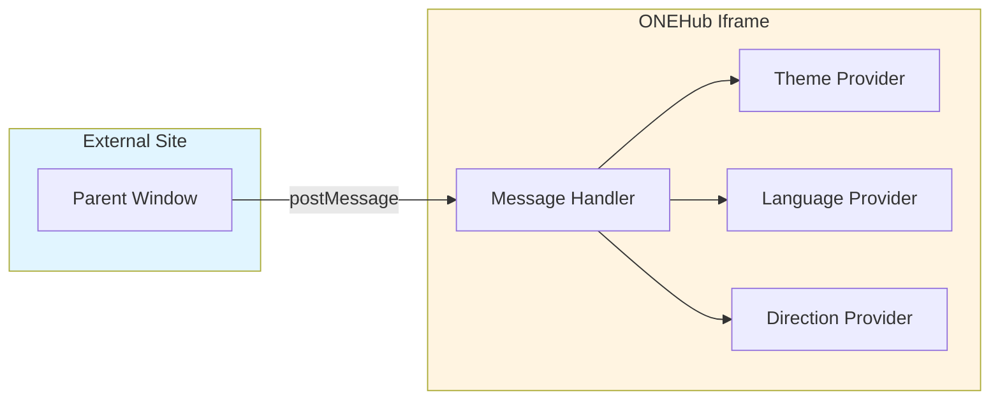
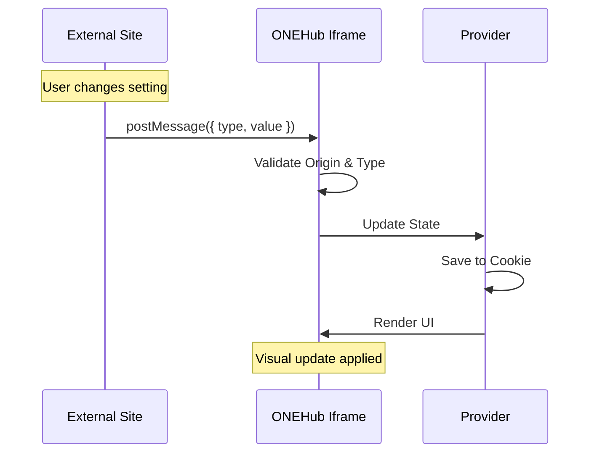

# ONEHub Iframe Integration Guide

## System Architecture



## Message Flow Sequence



## Integration Code Example

### HTML Setup
```html
<iframe
  id="onehub-iframe"
  src="https://your-onehub-domain.com/iframe/campaign-management"
  width="100%"
  height="800px"
  frameborder="0"
></iframe>
```

### JavaScript Implementation
```javascript
const onehubIframe = document.getElementById('onehub-iframe');
const targetOrigin = 'https://your-onehub-domain.com';

function sendMessageToONEHub(message) {
  onehubIframe?.contentWindow?.postMessage(message, targetOrigin);
}

// Change theme
sendMessageToONEHub({ type: 'THEME_CHANGE', theme: 'dark' });

// Change language
sendMessageToONEHub({ type: 'LANGUAGE_CHANGE', language: 'ar' });

// Change direction
sendMessageToONEHub({ type: 'DIRECTION_CHANGE', direction: 'rtl' });
```

## Supported Message Types

| Type | Properties | Values |
|------|-----------|--------|
| `THEME_CHANGE` | `theme` | `'light'`, `'dark'`, `'system'` |
| `LANGUAGE_CHANGE` | `language` | `'en'`, `'ar'`, `'th'`, etc. |
| `DIRECTION_CHANGE` | `direction` | `'ltr'`, `'rtl'` |

## Security Features

- ✅ Origin validation (must match `window.location.origin`)
- ✅ Message structure validation
- ✅ Message type whitelist validation
- ❌ Invalid messages are silently rejected

## Implementation Files Reference

- **Utilities**: [lib/iframe-utils.ts](../client-app/src/lib/iframe-utils.ts)
- **Theme Provider**: [context/theme-provider.tsx](../client-app/src/context/theme-provider.tsx)
- **Language Provider**: [context/language-provider.tsx](../client-app/src/context/language-provider.tsx)
- **Direction Provider**: [context/direction-provider.tsx](../client-app/src/context/direction-provider.tsx)
